# Music: Does hyper-resolution fail in 6G integrated tactile and auditory? The truth revealed in this "Resolution-Robustness Map" with Python code.

OFDM ISAC Waveform-Limited Cases: Hyper-Resolution Capability of Stepwise MUSIC and Robustness Performance Tony Johnson Master's Final Project, April 2026
Abstract: This project investigates the performance and robustness of a hyper-resolution method based on MUSIC in an integrated OFDM-ISAC environment with waveform limitations. A previous one-dimensional ranging study has demonstrated the clear advantages of MUSIC. The focus of this project is on a more challenging issue: whether the advantage can be maintained when employing communication-constrained waveforms—where there are fragmentation occupations in both the frequency domain and slow time domain, as well as structured clutter and coherent multipath within the scene.
The project compares a stepwise masked MUSIC estimator (with spatial forward and backward smoothing and support-aware distance/Doppler forward and backward smoothing) to a baseline method introducing local refinement through a masked FFT, both applied to the same deembedded OFDM observation data. Evidence comes from a set of preserved FR1 Monte Carlo packets, containing three indoor industrial scene categories, nine sets of publicly available scanning parameters, each set under 64 trials for each scene; along with additional extended analysis including 64 additional trials, including expected order MUSIC, model order verification based on feature value gaps, and controlled interference intensity scans.
The main findings are as follows: (1) Under the default MDL model order selection path, MUSIC only significantly outperforms in the cross-roads scenario, while the FFT baseline is superior in the open passage scenario and fails in the shelf passage scenario; (2) The model order estimation based on MDL is a real bottleneck because when using the expected order (K=2), MUSIC can recover to the performance level of the FFT in the open passage scenario and further widen its advantage in the already dominant cross-roads scenario; The blind feature value gap selector can narrow the gap but cannot save the clutter-dominated shelf passage scenario.(3) In clutter-dominated scenarios such as shelf aisles, the fixed model order is ineffective. The saved step-by-step diagnostics indicate that angle candidate values aligned with the direction of the interference source preemptively occupy the search path, preventing subsequent distance/Doppler processing from resolving correctly; (4) Therefore, the core contribution of this project lies in the creation of a "resolution-robustness" map, rather than presenting a generalized judgment on its merits and demerits.
1. Introduction and Motivation
Integrated sensing is a natural evolution direction for 6G, as future infrastructure is likely to share spectrum, aperture, computing power, and deployment sites between communication and perception tasks. A base station already transmitting broadband MIMO-OFDM waveforms is inherently a potential sensor. If the communication waveform itself is sufficient to support useful distance, velocity, and angle estimation, then the network does not need an additional radar frequency band or independent radio frequency frontend to acquire environmental perception capabilities.
However, the challenge lies in the fact that communication waveforms are not radar waveforms. In the OFDM resource grid after scheduling, only some resource units are occupied, pilots may be sparse, data symbols are usually unknown to the perception receiver, and the actual occupied support set (support) may be fragmented in frequency and slow time. These limitations directly weaken the three elements relied upon by classical superresolution processing:  
Continuous large bandwidth → used to characterize fine distance structure,  
Continuous slow time aperture → used to parse Doppler structure,  
and a dominant subspace stable covariance matrix that can maintain good shape even when facing missing support and coherent interference paths.  
Therefore, the core issue of this project is not "is MUSIC effective on an ideal radar cube", but:  
Under the constraints of the OFDM communication resource grid, with the help of forward-backward smoothing (FBSS)-based MUSIC, can relative to a fair FFT baseline achieve practical superresolution gain?  
This question is significant for 6G research because it tests whether subspace methods still hold up under real waveform constraints, not just in the idealized radar assumption.  
2. Problem statement and research scope
The project focuses on a narrow yet crucial range:
Two-target detection in indoor industrial scenes;
Perception of single-site OFDM based on similar private 5G FR1 waveforms;
Communication-constrained resource grid, whose occupancy support is fragmented.
Fair comparison between masked FFT baseline and masked stepwise MUSIC estimator;
And a set of submission-level Monte Carlo results stored in the "results/submission" path.
This report aims to answer four specific questions:
1  
What impact does waveform-constrained OFDM perception have on the super-resolution problem?
2  
How are MUSIC and FBSS adapted under this mask observation condition?
3  
What does the saved submission packets show under various nominal parameter points and scanning parameters?
4  
Which conclusions are robust, and which require careful qualification?
This report does not claim to achieve true 3D joint MUSIC, nor does it involve unknown data receivers, multi-target tracking systems or hardware demonstrations. It is merely a simulation study of the behavior of an estimator under waveform and scene constraints.
2.1 Relationship to Previous Work This project is situated at the intersection of two mature research lines. On one hand, recent literature on perceptual integration has defined "perception based on communication waveforms" as a core theme for 6G, with OFDM and MIMO-OFDM emerging as natural candidates due to their dominance in practical wireless systems. Previous joint radar communication work also indicates that the dual use of OFDM is highly appealing: the same multicarrier waveform can support both communication and delay-sensitive perception through processing of demodulated symbols.
On the other hand, The super-resolution technology used here is derived from classical array processing. Not specifically designed for a new integration of tactile and auditory perception. MUSIC is a classical subspace super-resolution parameter estimation method. Space smoothing and forward-backward space smoothing are used to handle the coherence of the source. Standard remediation measures for the loss of covariance rank due to multipath.
2.2 Motivation: The motivation for this one-dimensional ranging project is a simplified comparison of ranging techniques. Figure 1 illustrates the processing of two targets with a spacing of 0.70 times the Rayleigh resolution unit under conditions of full resource occupation, 96 subcarriers, 16 quick scans, and a 20 dB signal-to-noise ratio using MUSIC and FFT.
[Insert Figure 1: One-Dimensional Ranging Motivation. When supported over the entire frequency domain and the model order is known (K=2), MUSIC successfully separated two targets in 200 trials, while FFT could not do so at all. This project seeks to understand how much of this advantage remains when observations are forced to operate on a communication-scheduled OFDM resource grid, with fragmented support and structured clutter.]
Therefore, the novelty of this report is deliberately kept narrow. It does not propose new waveforms, new FBSS theories, or new joint estimators. It only poses a question: when perception is forced to operate on a communication-based OFDM resource grid, with fragmented support and structured multipath interference, can a stepwise, masked MUSIC processing flow still provide value? Perception reception under limited symbol knowledge still needs future expansion, but the basis of this paper's conclusion is known symbol perception to avoid mixing superresolution mechanisms with receiver-end symbol recovery failures.
3. Signal Model and Mathematical Background 3.1 Wideband OFDM Observation Model with Restricted Waveforms Let (h) represent the virtual horizontal channel index, (k) be the subcarrier index, and (n) be the slow time fast scan index within each slot. The communication-restricted observation model can be summarized as follows:
[y_{h,k,n} = m_{k,n} x_{k,n} \left( \sum_{p=1}{P} \alpha_p a_h(\theta_p) e{-j2\pi f_k \tau_p} e^{j2\pi \nu_p t_n} s_p[n] \right) + w_{h,k,n}]  
Where:  
(m_{k,n} ∈ {0,1}) is the resource support mask,  
(x_{k,n}) is the OFDM symbol transmitted on this resource unit,  
(\alpha_p) is the path gain.
(\theta_p), (\tau_p), (\nu_p) are respectively the azimuth angle, time delay and Doppler frequency of the target.
(a_h(\theta_p)) is a spatially-oriented term,  
(s_p[n]) is the source signal process at slow time fast-sampling (n) for the pth path,  
(w_{h,k,n}) is the complex receiver noise.  
For radar interpretation, distance and velocity are converted as follows:
[R = \frac{c\tau}{2}, \quad v = \frac{\lambda\nu}{2}]  
If the perception receiver knows some symbols transmitted on occupied resource units, de-embedding can be performed to form a masked perception cube:
\[ \tilde{y}{h,k,n} = \begin{cases} y{h,k,n} / x_{k,n}, & (k,n) \in \Omega_{\text{known}} \\ \text{otherwise}\end{cases} \]
This is exactly the core object that two types of main propagating estimators in this project are dealing with. Unlike radar-specific cubes, it contains structured zero elements and irregular support derived from communication scheduling and symbol knowledge.
3.2 Why communication scheduling makes super-resolution harder OFDM brings three direct constraints:
1  
Frequency domain support fragmentation: missing subcarriers reduce the equivalent bandwidth and destroy the covariance structure both dependent on FFT and subspace methods.
2  
Slow time support fragmentation: missing slow time fast shots (here by sampling once per time slot) shorten the coherent processing interval, affecting Doppler stability.
3  
Limited transmitter knowledge: if only pilot symbols are known, the perception receiver cannot cleanly de-embed the data-bearing resource unit unless it has more complete communication receiving capabilities.
These constraints make the problem closer to the realities of 6G integrated communications than classical radar.
3.3 In this project, MUSIC and FBSSMUSIC implement parameter estimation through signal and noise subspace decomposition of the covariance matrix and calculation of the following form of pseudo spectrum:
\[ P_{\text{MUSIC}}(\phi) = \frac{1}{|E_nH a(\phi)|_22} \]
The (E_n) is the estimated noise subspace, and (a(\phi)) is the steering vector for the parameters to be estimated. The peak of pseudospectrum indicates the corresponding direction, distance, or Doppler value. The main attraction of MUSIC lies in its ability to break through the grid resolution of FFT when the covariance estimation is reliable. The main risk is that the covariance estimation deteriorates sharply when the source is coherent or heavily masked.
FBSS addresses the problem of source coherence by averaging the covariance matrices of overlapping subarrays and performing forward-backward symmetry. In this project:
Space FBSS is always enabled in active MUSIC paths,
Distance FBSS is only enabled when it is known that the support contains a sufficient length of continuous frequency domain segments,
Doppler FBSS is only enabled when it is known that the support contains a sufficient length of continuous slow time segments.
A key point is that this estimator is perceptive: it does not assume that each mask OFDM mode can provide meaningful distance or Doppler smoothing array aperture.
3.4 An important architectural limitation in this project is that the active MUSIC method is stepwise, not truly three-dimensional joint estimation. It first performs dense azimuth search, followed by conditional distance MUSIC, then conditional Doppler MUSIC, and finally adds a step of local matching filter refinement. Therefore, a more accurate description should be: a stepwise with FBSS masked MUSIC flow, rather than a complete 3D joint MUSIC solver.
4. Research Design 4.1 The submission data packets used in the report are all major conclusions from the repository results tree, which have been saved as submitted data packets. The report also uses additional saved 64 test outputs for expected order diagnosis and interference intensity analysis. Tables and graphics are all derived from CSV files written to disk.
The scope of the submission data packets is as follows:
Only the anchor points of the FR1 band,
Each scan point 64 times of experiment,
3 types of scenarios,
9 sets of public scanning parameter families,
Each scenario 42 scan points plus one nominal working point.
1. Each test generates a CSV log for auditability.
The default final data packet deliberately keeps it concise: it retains the main known symbol comparisons, while moving only diagnostic products such as pilots, representative tests, and FBSS ablation out of the standard submission path. These diagnostic materials were useful during development but are not required for the paper's final claim set.
4.2 The waveform, array, and nominal resource mask table 1 summarizes the waveform and array configuration used in submitted packets.
It is worth noting that although half of the resource units are occupied, the occupied support sets span the entire bandwidth and slow time interval of the simulation. In practice, the slow time axis samples every 30 kHz NR slot once, with 16 quick shots corresponding to an 8 ms coherent processing interval. Therefore, the nominal working point is not a "small bandwidth" or "short CPI" point, but rather a fragmented but fully expanded point.
4.3 Scenarios and their real distinction tables 2 summarize the nominal scenario settings. These scenarios are not purely coherent cases. They differ in target pairs, signal-to-noise ratio, axis intervals, target power imbalance, clutter quantity, number of multipaths, and configured target coherence.
The configured target coherence values in the scenario generator are: open channel 0.15, crossroad 0.30, shelf channel 0.65. However, there is significant overlap between the limited quick shots' empirical coherence in the saved test logs. The empirical mean coherence of the open channel in the submitted packets is about 0.78, the crossroad is about 0.77, and the shelf channel is about 0.87.
Figure 2 clearly demonstrates this overlap by comparing the configured coherence with the empirical coherence in the nominal paired test logs. There is high overlap between the open channel and crossroad, even though the shelf channel also has a large overlap area with both others.
[Insert Figure 2 here: A comparison of the configured coherence with the empirical coherence in the nominal paired test logs. The empirical limited quick shot distribution significantly overlaps across all scenarios, thus scene comparison should be considered as a composite condition comparison rather than a clean single factor coherence scan.]
4.4 Public scanning parameter families submitted data packets evaluating 9 sets of public scanning parameter families:  
Allocation family,  
Occupied fraction,  
Fragmentation index,  
Bandwidth span,  
Slow-time span,  
Separation sweeps: distance, speed, angle,  
Nuisance gain offset - used for controlled clutter intensity studies.  
Among them, the separation sweeps are designed to be isolated on each axis: when scanning one axis, the intervals between the other two axes are set far greater than the Rayleigh limit to ensure they do not constrain each other. This is important for subsequent interpretations because overall victory in a scenario does not mean that it can be achieved in all isolated scans.  
5. Estimators and evaluation pipeline 5.1 The main comparison items report focuses on two main methods:  
1  
fft_masked: weighted masked FFT front + local matching filter refinement.  
2  
music_masked: stepwise masked MUSIC estimator with spatial FBSS, conditionally enabled support-aware distance/Doppler FBSS, and finally also followed by local matching filter refinement.  
This is a fair comparison: both use the same de-embedded masked observations and the FFT baseline is not just at the raw coarse detection stage - local refinement is one of its key performance improvements, which explains why the final results are more balanced than early optimistic expectations.  
5.2 Indices produce detection results, correlation with true targets, and summary metrics for each trial. The main probability metrics include:
(P_{\text{det}}): Both moving targets are detected within the detection threshold;
(P_{\text{joint}}): Both moving targets are successfully associated within the joint resolution threshold;
(P_{\text{range}}), (P_{\text{vel}}), (P_{\text{angle}}): Similar resolution probability for each axis independently.
The test evaluator uses normalized error metrics in distance, velocity, and orientation, and measures based on decomposed resolution units. The joint resolution success requires both targets to be detected within the detection threshold, and to fall within 0.35 times the nominal unit size across all three axes. This 0.35 unit threshold is the default value used in this configuration of the research. Appendix B tests the stability of this nominal criterion under proximity thresholds using stored trial association results without rerunning Monte Carlo.
Other usage indicators include:
False alarm probability,
Missed detection probability,
Unconditional joint association RMSE,
FFT and MUSIC difference (delta) for paired nominal trials.
For summary ratios, a 95% Wilson confidence interval is reported. Since the two primary methods share the same random seed at given scanning points, the paired trial comparison is meaningful.
6. Results 6.1 A nominal submission decision table 3 summarizes the results at the nominal FFR1 submission point for three scenarios.
Figure 3 presents the same result with Wilson intervals.
[Insert Figure 3: Nominal scenario decision table. The core conclusion supported by data is very narrow: MUSIC only outperforms FFT in the nominal crossroads scenario, fails in the nominal open channel scenario, and does not produce useful results in the nominal shelf channel scenario.]
The meaning of the nominal results is straightforward:
Open channel: A reasonable FFT baseline outperforms MUSIC.
Crossroad: MUSIC has a significant advantage over FFT.
Shelf channel: Both methods perform poorly, with MUSIC failing completely at the nominal point.
Based solely on this result, it is sufficient to negate any general assertion that "MUSIC generally performs better under waveform-constrained conditions."
6.2 The joint resolution results of the nominal paired test are not driven by individual extreme outliers as indicated in Table 4, which summarizes the joint resolution results from the saved test logs.
Figure 4 presents the unconditional joint association RMSE difference for the same comparison result in a continuous form. The positive value indicates that MUSIC is superior.
[Insert Figure 4: Nominal paired test difference in the saved submission data packet. The advantage in intersections is comprehensive and widespread, while the loss in open channels is systematic, with shelf channels mainly characterized by a common failure zone accompanied by a small number of mixed results.
The paired tests further solidify the nominal conclusions:
In open channels, only about 30% of the trials favor MUSIC over the RMSE difference;
In intersections, about 72% of the trials favor MUSIC;
In shelf channels, the dominant situation is one where both methods fail, rather than either having a clear advantage.
6.3 The paired statistics support because both main methods share the same seed for experiment generation, the submitted data packet provides precise pairwise testing based on the nominal points. Table 5 reports two tests based on the saved test logs: the exact McNemar test for the success or failure of the joint resolution of pairs, and the bilateral exact sign test (positive RMSE difference represents MUSIC being better).
These tests do not change the story but make it more convincing. The defeat in open channels and the victory in intersections is not just a visual mean difference, but also supported by the paired nominal tests. Shelf channels cannot support a stronger claim than "both methods here largely fail."
6.4 Representative negative samples preserved in the paired test logs also support deterministic negative examples. Their importance lies in demonstrating that this project is not dependent on a single favorable figure alone. Table 6 extracts two nominal paired test results from trial_level_results.csv.
These negative samples fit the overall pattern. The open channels contain real paired trials, where FFT refinement is sufficient, while stepwise MUSIC over-invests in a false option; the shelf channels are dominated by difficult clutter trials, and neither method can maintain two reliable joint associations.
6.5 Performance maps under various scanning parameter families When interpreted as a performance map rather than a single decision, it becomes more valuable. Figure 5 summarizes the results saved under different scanning parameter families.
[Insert Figure 5: Two performance maps saved from submitted data packets. Supported scans (assignment, occupation rate, fragmentation, bandwidth, slow time) are separated from axis isolation distance scans due to their different main indicators. Cell color represents the mean difference between MUSIC minus FFT within each family, with text displaying the number of strong victories at least +0.10.
1  
Open Channels: Among all 22 supported restricted scan points, there is no strong victories for MUSIC; only one among 15 axis isolation distance scan points. Adding FFT refinement generally makes this scenario FFT dominant.
2  
Intersections: In 22 supported restricted scan points, MUSIC widely wins (15 strong victories, with an average difference of positive values within each family); however, its specific axis advantages are much narrower: only effective on distance interval scans, not helpful in isolated speed and angle scans.
3  
Shelf Channels: MUSIC is ineffective in 22 supported restricted scan points and fails to save any nominal points; its positive gains are mainly concentrated in easier interval scans (especially distance and speed interval). This means that when the scene is artificially simplified, stepwise MUSIC still benefits.
This split performance map is the highest-level conclusion of the project. It indicates that under waveform-restricted conditions, MUSIC is neither universal nor indispensable. Its benefits are concentrated in specific scenarios and support intervals; supported restricted scan families and axis isolation distance scan families must be interpreted separately.
6.6 Diagnosis of Model Order
The MDL estimate systematically overestimates the true number of sources in the submitted data packets. The mean estimation order for each scenario ranges from 4 to 6, indicating that the masked covariance structure confuses the estimation of the azimuth order. To separate this effect, the project introduces an MUSIC variant with a fixed (K=2) expectation order. Subsequently, a frequency-domain order selector based on feature value gaps is added to examine whether the failure of MDL is due to a specific criterion or a more general phenomenon.
Table 7 summarizes the nominal results of the saved 64 trials.
The results are decisive for two out of three scenarios: In open channels, the original loss to FFT (P_joint = 0.563 vs. 0.719) was mainly due to model order illusion—the expectation order MUSIC recovered to a precise alignment with the FFT baseline, and the blind feature value gap selector also narrowed most of the gap (P_joint = 0.688), though not fully reaching the predictive result. In cross-channels, the feature value gap has reached P_joint = 0.844 with expectations, indicating that in this favorable scenario, MDL is not the only option for controlling order; in shelf channels, regardless of feature value gap or fixed K=2, there was no help, confirming that its failure mechanism differs.
This subsequent feature value gap test primarily serves as a robustness note, not as an alternative to the project's evidence base. It operates only at nominal points, while the performance maps and interference conclusions still come from scan results in the data packets. Its value is more localized: it indicates that blind order selection can improve in favorable scenarios, but does not change the broader conclusion that shelf channels are outside the useful working interval due to clutter dominance.
6.7 Azimuth Phase Fault Analysis
The nominal data packets in the preserved shelf channel experiments reveal why this scenario resists the above corrections. In failed shelf channel trials, the azimuth candidate list repeatedly shows a branch aligned with an interference source approximately -21.7° (approximately -24° on the left side of the shelf clutter), while the real second moving target (+5°) often misses its candidate. Ultimately, the final detection results either replicate easier targets or jump to that interference branch.
Figure 6 intuitively demonstrates this phenomenon. The left plot shows the histogram of all candidate orientations in 64 nominal trials; a persistent, near -21.7° interference alignment branch appears in each trial, while the two true targets (approximately -1° and +5°) only appear about half of the time. The right plot displays the final detection distribution of orientations: 50 out of 128 detection slots (39%) are captured by the interference branch, while the two true targets receive only 36 and 29 detections respectively.
[Insert Figure 6: Shelf Channel Orientation Phase Fault Diagnosis Diagram. Left: Histogram of all candidate orientations in 64 nominal trials, with true target orientations (blue dashed/solid lines) and clutter/multipath angles (red dotted/dotted-dashed lines). The persistent approximately -21.7° candidate aligns with the clutter on the left side of the shelf, appearing in each trial. Right: Final detection orientation distribution, showing that the interference branch captures 39% of the output, confirming that the spatial subspace is occupied as a failure mechanism.
The combination of expected order results still remains at P_joint=0, indicating that the main issue in the shelf channel is not model order. A more reasonable explanation is that clutter dominates the orientation phase fault: the interference scattering bodies capture the spatial subspace early on, and subsequent distance/Doppler processing cannot recover the lost second target.
6.8 Controlled Interference Intensity Study To directly test the clutter hypothesis, the project introduced an interference gain offset scan: offset the gains of all interference scattering bodies while keeping scene geometry, target positions, and nominal intervals unchanged. The saved scan evaluated the offset from the default scene value of -6, -3, 0, +3, +6 dB.
This test's cleaner version is the expected order scan, as it eliminates the confusion of MDL. Table 8 summarizes the saved expected order P_joint values.
This result provides the clearest boundary evidence for this project:
Open channels: Once model order is fixed, MUSIC can compete or even slightly outperform FFT at low to moderate interference levels, but performance deteriorates sharply when clutter is enhanced.
Intersection: The MUSIC algorithm is expected to maintain its strength throughout the entire test interference range and still maintain a significant gap against FFT at +6 dB.
Shelf passage: MUSIC remains zero, supporting the interpretation that this scenario has exceeded the clutter tolerance limit of the stepwise process.
The corresponding MDL interference scan serves primarily as a comparative reference: In the intersection, the MDL path degrades severely with increasing interference, dropping to 0.031 at +6 dB, while the expectation-based path remains at 0.781 at the same point. In the shelf passage, there is no improvement in either model order mode. Therefore, the results shown in the table provide a more reliable causal perspective by isolating the clutter effect from model order errors.
7. Discussion 7.1 The strongest and most convincing conclusion supported by this project is that:
MUSIC possesses real super-resolution capabilities under realistic OFDM integrated conditions, but its value highly depends on the working interval. Under the default MDL path, it only significantly outperforms in the intersection scene; when the model order is correct, it can also become competitive in open passages; however, in the clutter-dominated shelf passage, regardless of the model order, it fails.
This is stronger than simply declaring "MUSIC wins" or "MUSIC loses," and it is more useful. It reveals why the super-resolution advantage seen in previous one-dimensional ranging studies may not always extend to real three-dimensional stepwise operations and specifies the specific adjustable aspects and their limits: Model order control can recover some lost ground, while interference-dominated spatial subspaces define a more rigid boundary.
7.2 Three qualitative points need to be addressed with honesty:
First, differences between scenes should not be attributed simply to target coherence. They are composite intervals: SNR, nominal interval, target pairs, power imbalance, clutter quantity, and multipath layout differ. Since Figure 2 indicates that the empirical coherence across all scenes is highly overlapping, the report avoids attributing scene results to coherence as a single factor.
Second, the MUSIC algorithm's desired order needs to be appropriately positioned. In this fixed-target study, it serves as a foreknowledge diagnostic tool rather than a scalable model order solution. Its value lies in revealing what performance can be achieved once the subspace dimension is no longer the dominant fault mode.
Third, the subsequent testing of nominal eigenvalue gaps should also be cautiously defined. It demonstrates that MDL is not the only bad thing; a better blind heuristic could recover most of the nominal performance lost in open channels and completely restore it at crossovers. However, since it is evaluated only at nominal points, it cannot replace the scan results in packets as the main evidence for project performance maps.
These points narrow down the causal mechanism claims but do not negate the experience comparison itself. The saved CSV still supports the estimations compared by this report.
7.3 Applicability to 6G This result has three implications for readers targeting 6G:
1.  
It studies perception based on the communication waveform itself, not radar-specific waveforms.
2.  
It uses constrained conditions similar to scheduling decisions, not ideal continuous radar occupation.
3.  
It provides a performance map, which is more guiding for system design than a general positive conclusion.
The practical implication conveyed is not "everywhere implement MUSIC," but rather, MUSIC is a conditional tool for communication-restricted perception. It is worth considering when the scene geometry, clutter intensity, and supporting conditions generate real super-resolution needs and provide available covariance structures. It should not become the default replacement for a strong FFT baseline.
The saved run time summary also further sharpens the engineering interpretation. At nominal FR1 points, MUSIC adds about 0.19–0.26 seconds to total run time per scan point compared to FFT, increasing single-point run time from about 0.76 seconds to 0.96–0.99 seconds, an increase of about 25–30%. Since both methods share frontend and a large amount of preprocessing overhead, the main objection against MUSIC in this study is not just run time. A more important question is whether this additional overhead is worth it within a given work interval.
7.4 Relationship with Fundamental Theoretical Domain
This project did not calculate the Cramér-Rao bound (CRB) for this masked observation model. The classic conclusion that MUSIC approximations are efficient in CRB calculation, known under the condition of known model order and non-correlated, fully supported cases, holds true. However, two characteristics of this problem make direct CRB calculation complex:
Firstly, fragmented support masks (m_{k,n}) lead to an atypical Fisher information structure. The likelihood of observations depends on which resource units are known, and the effective Fisher information matrix is a function of the support pattern, not merely a simple function of array geometry and SNR. Calculating the CRB for each scan point requires evaluating the Fisher information under specific mask implementations, which is feasible but beyond the scope of this project.
Secondly, the stepwise architecture decomposes the joint 3-D estimation problem into sequential 1-D problems. The CRB of the stepwise estimator differs from that of the joint problem, and the gap between them depends on the condition error transmitted through previous stages. This stepwise loss itself is precisely the quantity we measured empirically but did not provide analytical bounds for in this project.
As a background reference, the unconditional joint association RMSE observed in the submitted data packets (around 0.2–0.5 normalized resolution units at nominal points) is much higher than the prediction value of classical CRB analysis under similar SNR and fully supported, known order scenarios. This discrepancy aligns with our main findings: waveform limitations and model order misestimation are the dominant limiting factors in performance, not constraints by the fundamental information bounds.
7.5 Important Limitations Still Remain Several limitations need to be clearly stated:
The active estimator is stepwise rather than truly joint 3-D MUSIC.
The research is limited to two moving targets and a small number of scene templates.
The scene categories are composite intervals, not clean single-factor coherent scanning.
The submission snapshot is limited to FR1 only.
Based on MDL, the estimation of model order in mask covariance leads to systematic failures and persistent overestimation of source number; while the variant of the expected order suggests that performance can be recovered after removing this error, actual systems still require a robust estimation method for model order against mask covariance.
The study is purely simulation-based and does not include hardware, channel estimation errors, or feedback constraints on communication links.
8. Conclusion The project aims to answer whether the MUSIC superresolution advantages demonstrated in one-dimensional ranging studies persist when dealing with fragmented waveforms, structured clutter, and coherent multipath interference in a three-dimensional OFDM integrated operation limited by waveform congestion.
The answer is conditional but clear:
Under the default MDL path, MUSIC only maintains its true superresolution capabilities within favorable intervals—surpassing the FFT baseline at crossovers, but failing open channels, and completely collapsing in shelf channels. The apparent failure in open channels is largely due to model order illusions: the expected order MUSIC can recover there to match the FFT, further solidifying its significant advantage at crossovers, indicating that once the subspace dimensionality is controlled, the underlying superresolution mechanism can still work. Shelf channels represent a different failure pattern: the direction of interference-aligned candidate values dominates the stepwise search, and any model order correction cannot restore performance. The interference scan through expectation orders reveals three distinct intervals: open channels are conditionally beneficial before strong clutter, crossovers maintain stability within the test interference range, and shelf channels always fall outside the effective working boundary.
Therefore, the core contribution of the project is to draw a resolution-robustness map for MUSIC in realistic OFDM integrated environments. It identifies two key failure mechanisms (model order overestimation under mask covariance, and interference source-dominated spatial subspace capture), and indicates that the former can be corrected, while the latter defines a hard boundary.
Future work should focus on:
1. Robust model order estimation methods against mask OFDM covariance (e.g., information theory criteria with missing support penalty correction);
2.
Perceptual clutter subspace methods, which can separate interference contributions before step-by-step search;
3
And also surpass simple fill-in-the-blank finite symbol knowledge receiver path.
In its scope, this project provides a truthful and mechanism-based study on where and why subspace superresolution in communication-constrained OFDM coherent integration occurs.
Appendix A Summary of Estimator and Evaluation Settings Table 9 summarizes the most important implementation settings among active main promoters. Its purpose is not to reiterate each run-time parameter but to transparently present fairness assumptions and evaluation default values in one place.
Appendix B Nominal Threshold Sensitivity Table 10 recalculates nominal joint resolution probabilities from stored iterative association logs with multiple neighboring joint resolution thresholds, without rerunning Monte Carlo. The key point is that nominal decisions remain stable: open channels always favor FFT, crossover channels always favor MUSIC, and shelf channels are always common failure zones throughout the threshold range.

## Images

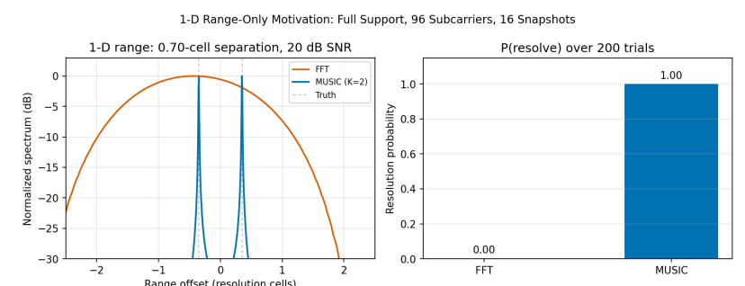
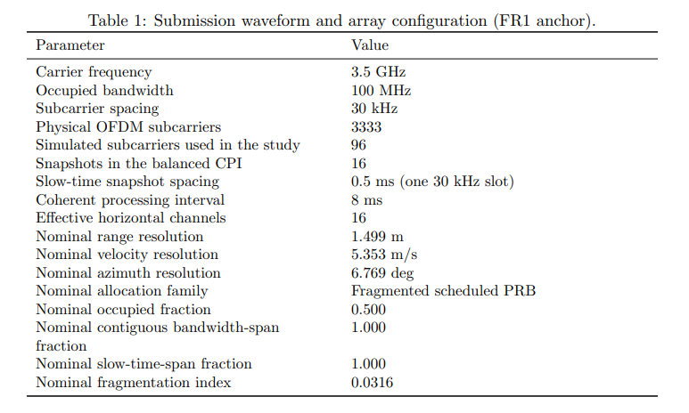
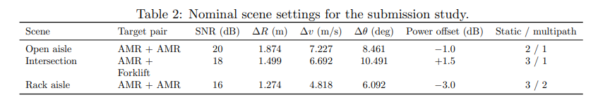
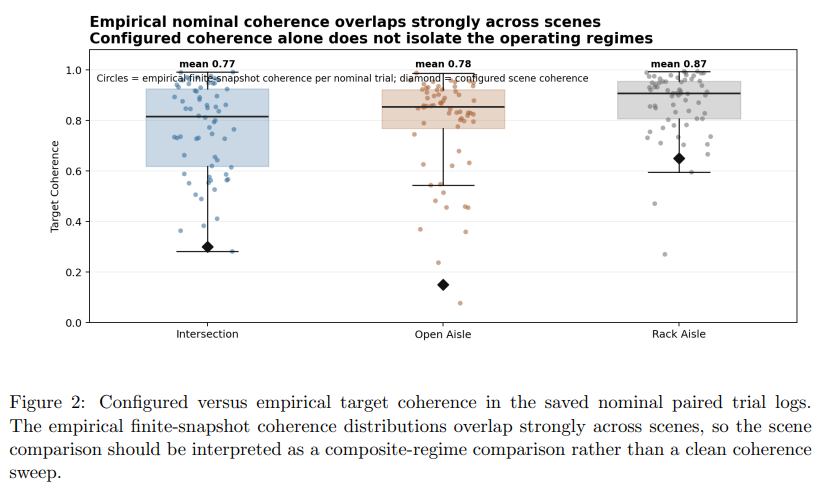
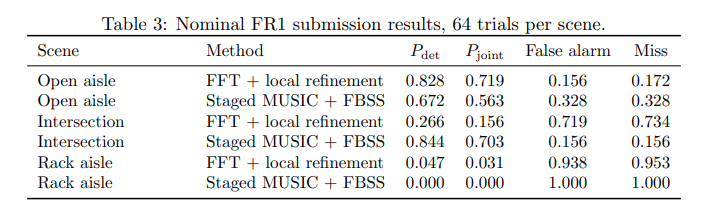
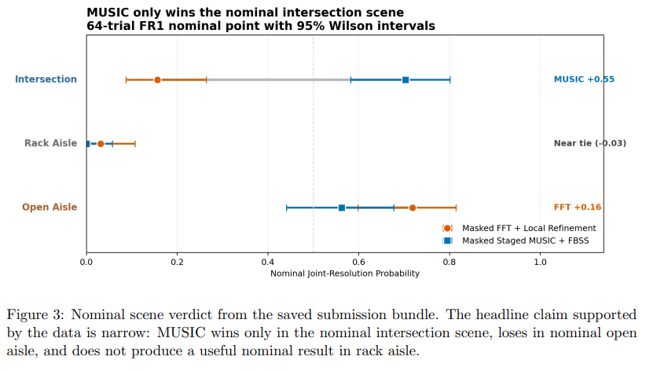
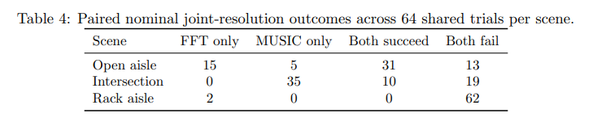
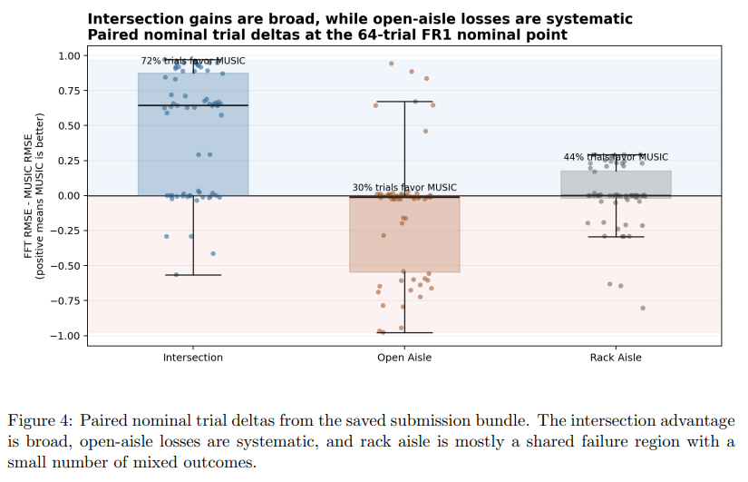
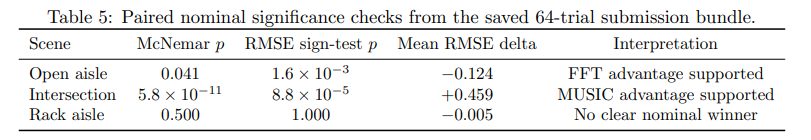
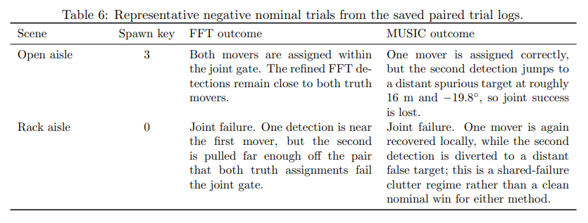
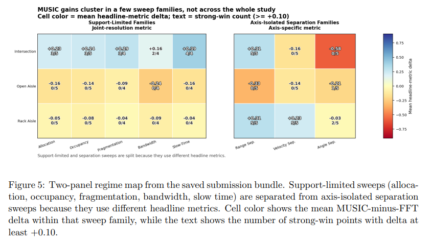
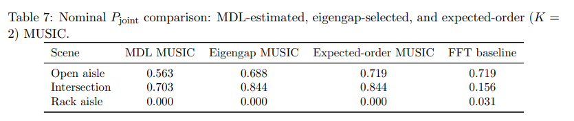
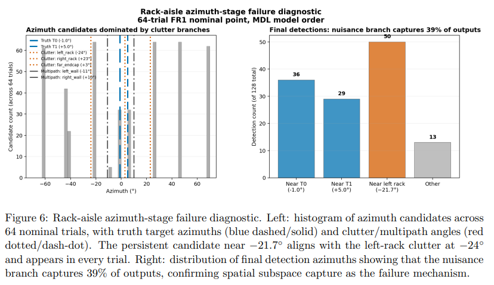
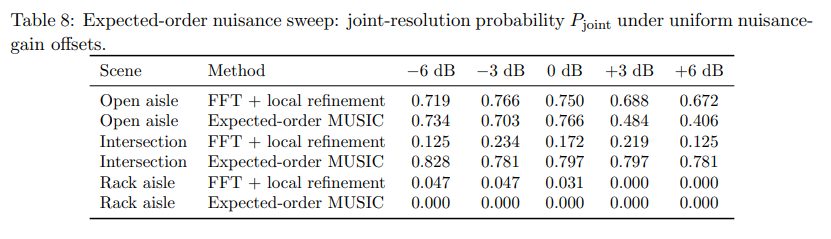
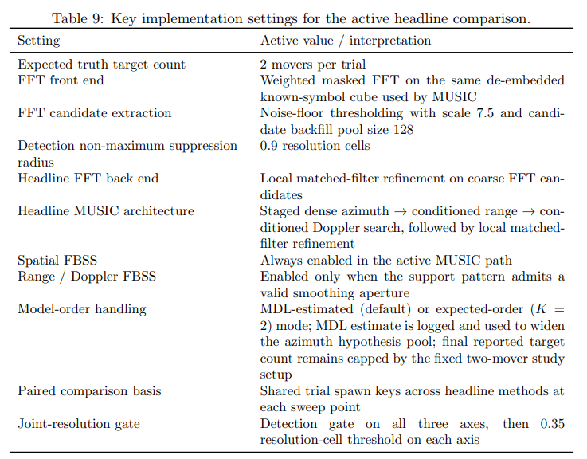
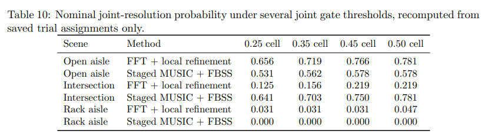

<!-- PAYMENT_BLOCK -->

## Get this dataset

- Payment link (Stripe): [Buy now](https://buy.stripe.com/3cs8yP7sY87d0vu9AB)
- Payment QR code: 

<!-- /PAYMENT_BLOCK -->
